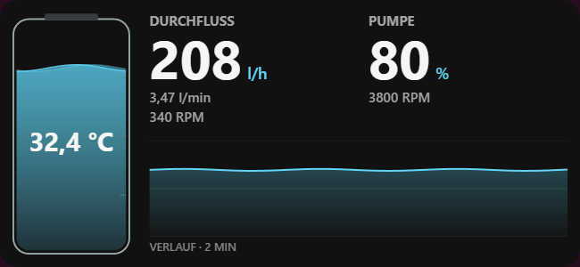

# Loop Flow

Ein Widget für [HYTE Nexus 3](https://github.com/hello-nexus/nexus), das den Zustand einer
Wasserkühlung anzeigt: Durchfluss, Pumpenleistung, Pumpen-RPM, Wassertemperatur und einen
Verlauf der letzten zwei Minuten. Gedacht für das Gehäusedisplay (z. B. HYTE Y70 Touch Infinite),
läuft aber auch auf dem Desktop-Dashboard und dem Monitor.

*English version below.*



## Funktionen

- **Durchfluss** in l/h oder l/min, berechnet aus der Drehzahl eines Flow-Sensors am
  Lüfteranschluss des Mainboards: `l/min = RPM ÷ Faktor`. Der Faktor ist einstellbar
  (Standard 98, passend zum Barrow SLF-V3).
- **Pumpe** mit der von Nexus gemeldeten Leistung in % und der Pumpen-RPM.
- **Wassertemperatur** aus einem beliebigen Nexus-Temperatursensor (optional).
- **Verlaufsdiagramm** des Durchflusses und ein animierter Behälter.
- Acht Sprachen (DE, EN, FR, ES, IT, PT, NL, PL), automatisch nach der Nexus-Sprache.
- **Nur lesend:** Das Widget nutzt ausschließlich `cooling.state` und ändert nichts an der
  Lüftersteuerung oder an Kühlungsprofilen.

Der gefüllte Behälter zeigt die Pumpenleistung, **keinen gemessenen Wasserstand**.

## Voraussetzungen

- Windows mit **HYTE Nexus 3.1.8** oder neuer
- Pumpe und Flow-Sensor an Lüfteranschlüssen, die Nexus erkennt

## Installation

1. Repository herunterladen (*Code → Download ZIP*) und entpacken.
2. Nexus über das Symbol neben der Windows-Uhr mit **Beenden / Quit** vollständig schließen.
3. Windows PowerShell **als Administrator** im entpackten Ordner öffnen und ausführen:

   ```powershell
   powershell.exe -NoProfile -ExecutionPolicy Bypass -File .\Install.ps1
   ```

   Das Skript kopiert die fertig gebauten Dateien aus `com.jan.loopflow` nach
   `%ProgramData%\Nexus\apps\com.jan.loopflow` und sichert eine vorhandene ältere Version.
4. Nexus starten und eine **Loop Flow**-Kachel hinzufügen (4×4 empfohlen).
5. In Nexus am PC **Seitenleiste → Mehr anzeigen → Loop Flow** öffnen und dort Pumpenkanal,
   Flow-Sensor, optional den Temperatursensor sowie den Faktor wählen. Änderungen werden
   automatisch gespeichert.

Details, Update und Deinstallation: [INSTALLATION.md](INSTALLATION.md).

## Bekannte Einschränkungen

- Nexus gibt Widgets keine Lüfterkurven frei. Eine Kurvenauswahl ist deshalb nicht möglich.
- Nach einem Windows-Neustart meldet Nexus für manche Pumpen 0 %, obwohl die Kurve einen
  höheren Wert vorgibt. Das ist ein Fehler in Nexus, nicht im Widget:
  [hello-nexus/nexus#38](https://github.com/hello-nexus/nexus/issues/38). Ein Neustart von Nexus
  behebt es. Loop Flow zeigt den gemeldeten Wert unverändert an und weist auf 0 % hin.
- Getestet mit einem Gigabyte X570 AORUS ELITE (ITE IT8688E), einer D5-Pumpe und einem
  Barrow SLF-V3. Andere Hardware sollte funktionieren, ist aber nicht geprüft.

## Entwicklung

Node.js 22.18 oder neuer wird benötigt.

```text
npm run setup     # gepinnte Nexus-SDK-Quelle und esbuild holen
npm run build     # widget.mjs, renderer.mjs und die Vorschau bauen
npm run validate  # Manifest mit der offiziellen SDK-CLI prüfen
npm test          # Tests
npm run preview   # Designvorschau mit Beispieldaten unter http://127.0.0.1:8765
```

Mehr dazu in [docs/DEVELOPMENT.md](docs/DEVELOPMENT.md) und
[docs/ARCHITECTURE.md](docs/ARCHITECTURE.md). Die übrigen Dokumente (`PROJECT_CONTEXT.md`,
`AGENTS.md`, `START_HERE.md`) sind Notizen für die Arbeit mit KI-Coding-Assistenten.

---

## English

Loop Flow is a widget for [HYTE Nexus 3](https://github.com/hello-nexus/nexus) that shows the
state of a custom water loop: flow rate, pump duty, pump RPM, coolant temperature and a
two-minute history. It is designed for the case display (e.g. HYTE Y70 Touch Infinite) and also
works on the desktop dashboard and monitor surfaces.

**Features**

- **Flow rate** in l/h or l/min, calculated from the RPM of a flow sensor on a motherboard fan
  header: `l/min = RPM ÷ factor`. The factor is configurable (default 98, matching the Barrow SLF-V3).
- **Pump** duty in % as reported by Nexus, plus pump RPM.
- **Coolant temperature** from any Nexus temperature source (optional).
- Flow history chart and an animated reservoir. The reservoir fill shows pump duty,
  **not a measured coolant level**.
- Eight languages, picked automatically from the Nexus language.
- **Read-only:** uses only `cooling.state` and never changes fan control or cooling profiles.

**Install** (Windows, Nexus 3.1.8 or later): download and unzip the repository, fully quit Nexus
from the tray icon, then run in an elevated Windows PowerShell inside the folder:

```powershell
powershell.exe -NoProfile -ExecutionPolicy Bypass -File .\Install.ps1
```

Start Nexus, add a **Loop Flow** tile (4×4 recommended), then open
**Sidebar → Show more → Loop Flow** on the PC to pick the pump channel, flow sensor, optional
temperature source and factor. Settings save automatically.

**Known limitations:** Nexus does not expose fan curves to widgets. After a Windows restart, Nexus
may report 0% duty for some pumps although the curve requests more; this is a Nexus bug
([hello-nexus/nexus#38](https://github.com/hello-nexus/nexus/issues/38)) and restarting Nexus
fixes it. Tested on a Gigabyte X570 AORUS ELITE (ITE IT8688E) with a D5 pump and a Barrow SLF-V3.

The in-app texts are localized; the project documentation is in German.

## Lizenz / License

[MIT](LICENSE). Loop Flow ist ein privates Projekt und wird nicht von HYTE veröffentlicht oder
unterstützt. / Loop Flow is a personal project and is not published or endorsed by HYTE.
